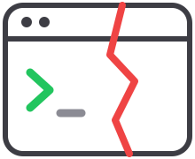
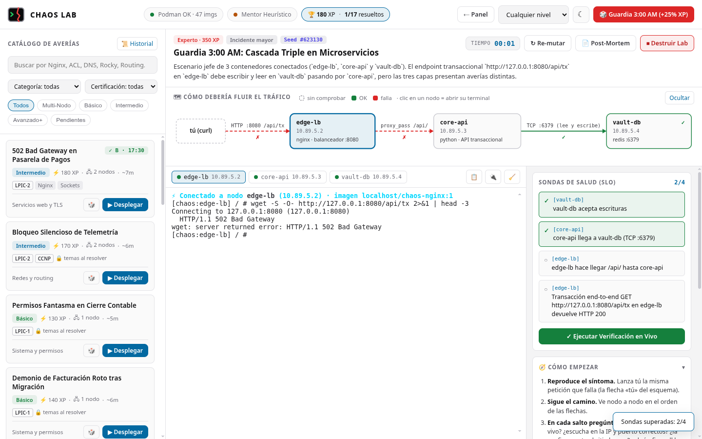

<p align="center"></p>

# Chaos Lab — Arena de incidentes Linux, redes y SRE

Laboratorio local de averías reales (*Break & Fix*): despliega uno o varios contenedores con un fallo inyectado (o una tarea por hacer), te da una terminal en cada uno desde el navegador y comprueba en vivo, capa por capa, si lo has arreglado.

Pensado para practicar troubleshooting de verdad (LPIC-1/2, CCNA, AZ-104, guardias SRE) sin romper tu sistema: todo ocurre en contenedores aislados que se destruyen al terminar.



## Qué tiene

- **87 escenarios** de dos tipos:
  - **Averías** (22): llega roto y lo arreglas. Proxies y 502, cortafuegos, DNS, routing, VPN y MTU, TLS, permisos y ACL, sudo, cron, y Blue Team (fuerza bruta SSH, escaneo de puertos, exfiltración por DNS).
  - **Tareas** (65): configúralo desde cero y un corrector comprueba cada paso. Vienen en *packs* por certificación: Linux Essentials, LPIC-1 (101 y 102) y LPIC-2 · LDAP.
- **Terminal real en cada nodo** (xterm.js por WebSocket): `vim`, `nano`, `Tab`, `Ctrl+C`… Cada nodo trae de serie nano, vim, less, curl, ss, dig y ps, y la interfaz te dice qué herramientas tiene.
- **Esquema de la topología** (Cytoscape.js) con cada red como una caja, sus máquinas dentro y el recorrido de la petición; tras «Verificar» se pone verde donde ya funciona y rojo donde no. Clic en un nodo abre su terminal.
- **Catálogo con filtros** (avería o tarea, certificación, categoría, nivel) y **ficha de vista previa** de cada escenario antes de desplegarlo.
- **Semilla aleatoria**: cada despliegue cambia puertos, contraseñas, nombres de procesos o subredes, para que diagnostiques en vez de memorizar.
- **Sondas sin spoilers**: dicen *qué* tiene que funcionar, nunca qué está roto ni la respuesta. Las pistas son graduales.
- **Modo Guardia 3:00 AM**: avería al azar con solo una alerta tipo PagerDuty; sin título, sin esquema detallado y sin etiquetas de sondas.
- **Mentor socrático** (opcional, con [Ollama](https://ollama.com) local) que lee los comandos que ya probaste, y **post-mortem en Markdown** con la cronología.

## Requisitos

- Linux con **Podman 4+** (rootless) **o Docker** 24+. Probado en Debian 13 con Podman 5.4 y en Ubuntu 24.04 con Docker 29.
  Si tienes los dos, usa Podman; para forzar uno: `CHAOS_RUNTIME=docker` en `.env`.
- **Python 3.11+** con el módulo `venv` (`apt install python3-venv` en Debian/Ubuntu).
- ~3 GB libres para las imágenes y **conexión a internet la primera vez** (se construyen las imágenes y se instalan las dependencias).

## Instalación y uso

```bash
git clone https://github.com/vladimircarpiomorales/chaos-lab.git && cd chaos-lab
./arrancar.sh              # la 1ª vez prepara .venv e imágenes; luego abre http://127.0.0.1:7820/
./arrancar.sh --estado     # salud del servidor y del motor de contenedores
./arrancar.sh --reiniciar  # reinicia el servidor (¡destruye el laboratorio en curso!)
./arrancar.sh --parar      # para el servidor y borra los contenedores chaoslab-*
```

Elige un escenario, pulsa **▶ Desplegar**, investiga en las terminales y pulsa **Verificar** cuando creas que está arreglado.

## Escenarios

### Packs por certificación

| Pack | Escenarios | Imagen | Ejemplos |
|---|---|---|---|
| Linux Essentials (010-160) | 14 | Debian | ficheros y permisos, usuarios, búsquedas, empaquetado, scripts |
| LPIC-1 · 101-500 | 18 | Debian y Fedora | filtros y expresiones regulares, permisos y enlaces, ext4 y MBR en una imagen, paquetes deb/rpm, procesos, vi, módulos, tmux |
| LPIC-1 · 102-500 | 27 | Debian | entorno y scripts, cron y at, sudo y SSH, X con xauth, red e IPv6, chrony, rsyslog y logrotate, journalctl, alias de correo, GnuPG |
| LPIC-2 · Redes (201-450) | 1 | 4 nodos: pc, 2 routers y servidor, en redes manuales sin IPAM | rutas y puertas de enlace, rutas de vuelta, nftables, /etc/hosts, tcpdump salto a salto |
| LPIC-2 · LDAP (202-450) | 10 | 2 nodos: servidor y cliente | ldapsearch/ldapadd/ldapmodify, índices en cn=config, slapcat, ACL, StartTLS y ldaps, PAM en el cliente con SSSD |

Las tareas marcan sus objetivos del temario LPI y el corrector enseña cada paso como ✔/✘ al pulsar **Verificar**.

### Averías (incidentes)

| Escenario | Nivel | Nodos |
|---|---|---|
| Permisos Fantasma en Cierre Contable | Básico | 1 |
| Demonio de Facturación Roto tras Migración | Básico | 1 |
| 502 Bad Gateway en Pasarela de Pagos | Intermedio | 2 |
| Bloqueo Silencioso de Telemetría | Intermedio | 2 |
| Fuga Desbocada en /var/log con Persistencia | Intermedio | 1 |
| Secuestro de Resolución y Caché Desincronizada | Intermedio | 2 |
| Bloqueo Total de Sudoers y Cuenta Operativa | Intermedio | 1 |
| VirtualHost Fantasma y 403/503 Encadenados | Intermedio | 1 |
| Fallo X.509 de SAN en Pasarela Corporativa HTTPS | Intermedio | 2 |
| Zona DNS Autoritativa: Serial SOA y CNAME Roto | Intermedio | 2 |
| Fuerza Bruta SSH: Detectar y Bloquear con nftables | Intermedio | 3 |
| Escaneo de Puertos: Detección y Mitigación con nftables | Intermedio | 3 |
| Agujero Negro de Enrutamiento hacia Subred Remota | Avanzado | 2 |
| Túnel WireGuard S2S Caído y Bloqueo por MTU | Avanzado | 2 |
| Exfiltración por DNS: Cazar el Proceso y Cortar la Salida | Avanzado | 3 |
| Guardia 3:00 AM: Cascada Triple en Microservicios | Experto | 3 |
| Cloud Networking: UDR, NVA Forwarding y NSG | Experto | 3 |

## Configuración

Opcional, en un fichero `.env` en la raíz del repo (no se sube a git):

| Variable | Por defecto | Para qué |
|---|---|---|
| `CHAOS_PORT` | `7820` | Puerto de la interfaz web |
| `CHAOS_HOST` | `127.0.0.1` | Dirección de escucha (déjala en local, ver *Seguridad*) |
| `CHAOS_RUNTIME` | autodetección | `podman` o `docker` |
| `CHAOS_PANEL_URL` | (vacío) | Si lo pones, sale un botón «← Panel» que vuelve a esa dirección (p. ej. tu dashboard) |
| `CHAOS_EXPORT_DIR` | `./exports` | Dónde se guardan los post-mortem (p. ej. una carpeta de tu bóveda de Obsidian) |

Las imágenes `chaos-debian`, `chaos-rocky`, `chaos-nginx`, `chaos-redis`, `chaos-lpic-debian`, `chaos-lpic-fedora`, `chaos-ldap-srv`, `chaos-ldap-cli` y `chaos-redes` se construyen con `images/construir.sh` (lo hace `arrancar.sh` solo si faltan; la primera vez tarda unos minutos). Si no existen, se usan las imágenes oficiales, que funcionan pero sin las herramientas de serie.

## Seguridad

- El servidor escucha **solo en `127.0.0.1`**. No lo expongas a la red: da una shell root dentro de los contenedores a quien abra la página.
- Los contenedores corren como **root dentro del contenedor** (rootless desde fuera con Podman; con Docker, según tu instalación) y algunos escenarios piden `NET_ADMIN`/`NET_RAW` para tocar rutas y cortafuegos **dentro** de su propia red.
- Los nodos con `sysctl_rw` (routers de los labs de redes) llevan `--security-opt systempaths=unconfined` para poder hacer `sysctl -w net.ipv4.ip_forward=1`: dejan `/proc/sys` escribible en ese contenedor (sin `--privileged`; `kernel.*` sigue denegado).
- Todo ocurre en redes aisladas `chaoslab-*`; `--parar` borra contenedores y redes.
- El usuario de prácticas `alumno` tiene la contraseña `alumno`: solo existe dentro de los contenedores.

## Desarrollo

```bash
.venv/bin/pip install pytest
.venv/bin/python -m pytest -q tests                       # coherencia, esquemas y reglas sin spoilers (sin contenedores)
tests/e2e/probar.sh <escenario> tests/e2e/soluciones/<escenario>.sh   # prueba real: despliega, resuelve y verifica
```

¿Quieres añadir un escenario? Lee [CONTRIBUTING.md](CONTRIBUTING.md). Cada avería es una función `_build_*` en `chaos_lab/scenarios.py` (o `scenarios_secops.py`) que devuelve nodos, setup con la avería, sondas, pistas, esquema y solución. Las tareas de los packs son JSON en `chaos_lab/packs/` (preparación, corrector y solución).

## Licencia

[MIT](LICENSE). Incluye [xterm.js](https://xtermjs.org/) y [Cytoscape.js](https://js.cytoscape.org/) (MIT, ver `static/vendor/LICENSE-xterm` y `LICENSE-cytoscape`).
